# Proposed system screens

Full-length presentation designs prepared on 16 October 2026 for the Morgan HR Skills Matrix. All people, pay figures, scores and framework settings shown are fictional or illustrative. The [specification](specification.md) defines the required behaviour, permissions and HR approval boundaries; these images show the proposed visual direction.

Each screen is an original **3,840 px wide PNG**, with its full page height preserved. Select an image to open the full-resolution file. The later editable Figma layout target is 1,920 px wide with a 1,440 px content area; that conversion is deferred, and these are the original presentation exports.

## Screen overview

[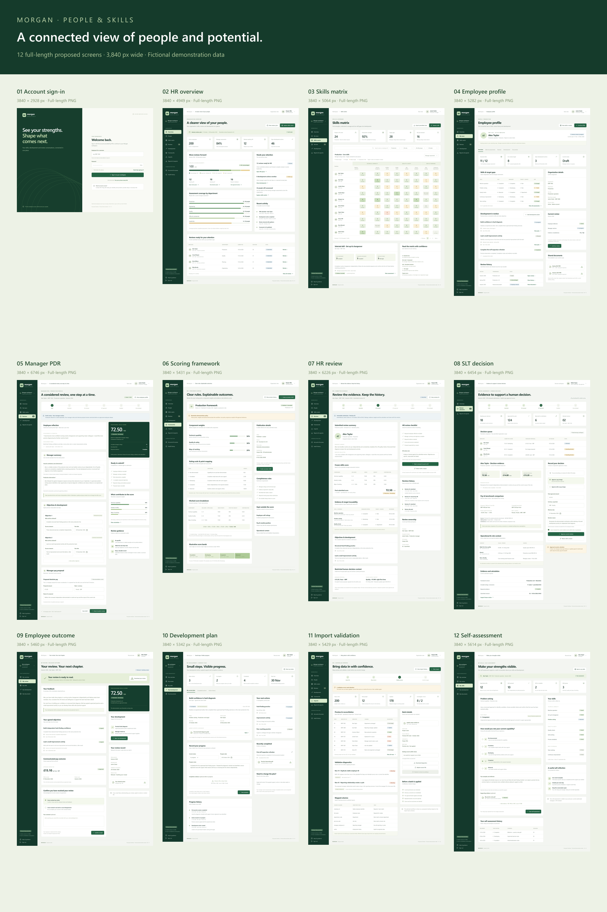](images/visual-design/morgan-screen-overview.png)

| Screen | Primary audience | Image size |
| --- | --- | --- |
| [01 Account sign-in](#01-account-sign-in) | All users | 3,840 × 2,928 px |
| [02 HR overview](#02-hr-overview) | HR | 3,840 × 4,949 px |
| [03 Skills matrix](#03-skills-matrix) | Authorised managers and HR | 3,840 × 5,064 px |
| [04 Employee profile](#04-employee-profile) | Authorised managers and HR | 3,840 × 5,282 px |
| [05 Manager PDR](#05-manager-pdr) | Allocated manager | 3,840 × 6,746 px |
| [06 Scoring framework](#06-scoring-framework) | HR framework administrators | 3,840 × 5,431 px |
| [07 HR review](#07-hr-review) | HR reviewers | 3,840 × 6,226 px |
| [08 SLT decision](#08-slt-decision) | Authorised SLT decision makers | 3,840 × 6,454 px |
| [09 Employee outcome](#09-employee-outcome) | Employee | 3,840 × 5,460 px |
| [10 Development plan](#10-development-plan) | Employee and authorised manager | 3,840 × 5,342 px |
| [11 Import validation](#11-import-validation) | Authorised import administrators | 3,840 × 5,429 px |
| [12 Self-assessment](#12-self-assessment) | Employee | 3,840 × 5,614 px |

## 01 Account sign-in

Local account access using a staff identifier and password, with a clear route to account help. See [organisation and identity](specification.md#4-organisation-and-identity).

[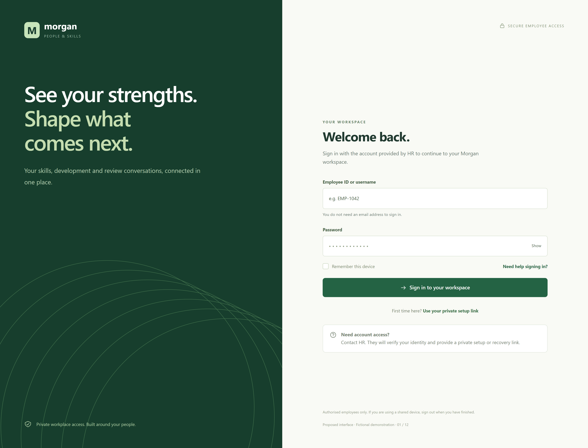](images/visual-design/01-sign-in.png)

## 02 HR overview

An organisation overview of review progress, assessment coverage, activity and items requiring attention. See [user experience](specification.md#11-user-experience).

[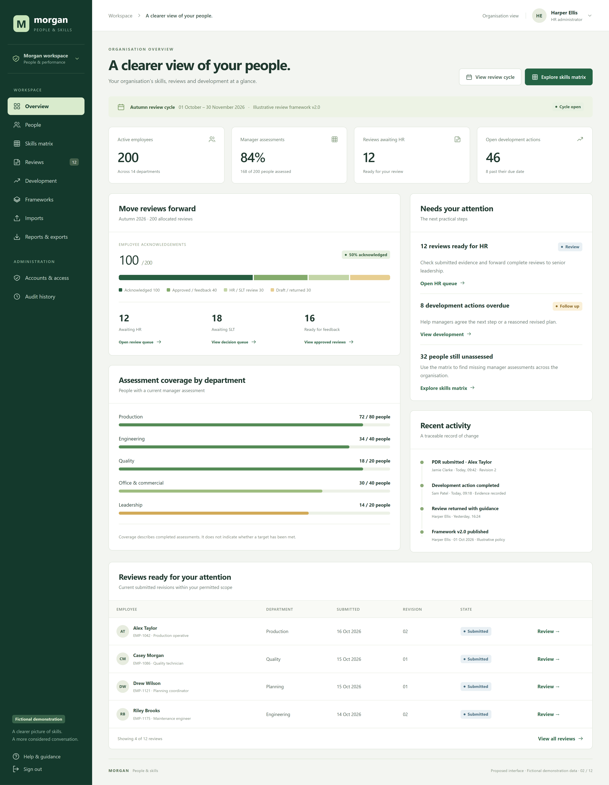](images/visual-design/02-hr-overview.png)

## 03 Skills matrix

Grouped skills, filtered employees, rating and target context, and a selected gap summary. Missing assessments remain distinct from assessed zero. See [catalogue, targets and assessments](specification.md#6-catalogue-targets-and-assessments).

[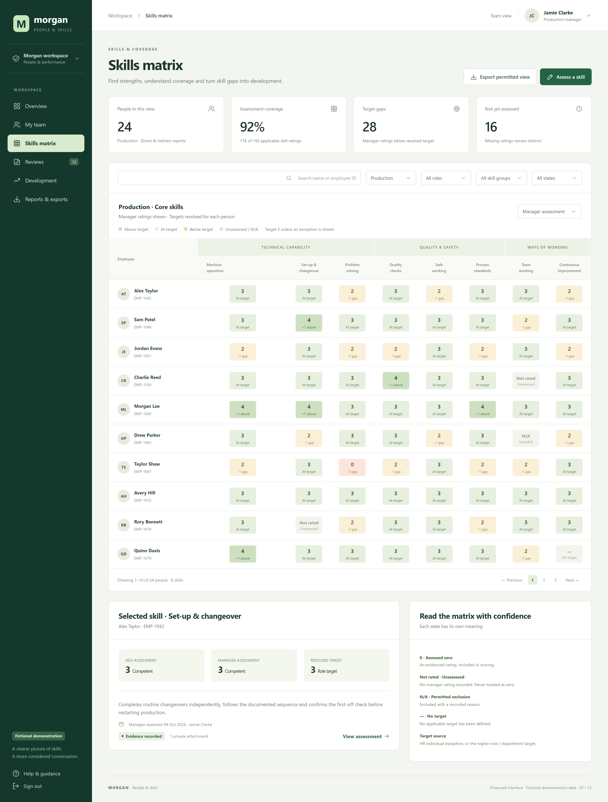](images/visual-design/03-skills-matrix.png)

## 04 Employee profile

An authorised staff view bringing together organisation details, skill gaps, development actions and review history. See [permissions and information boundaries](specification.md#5-permissions-and-information-boundaries).

[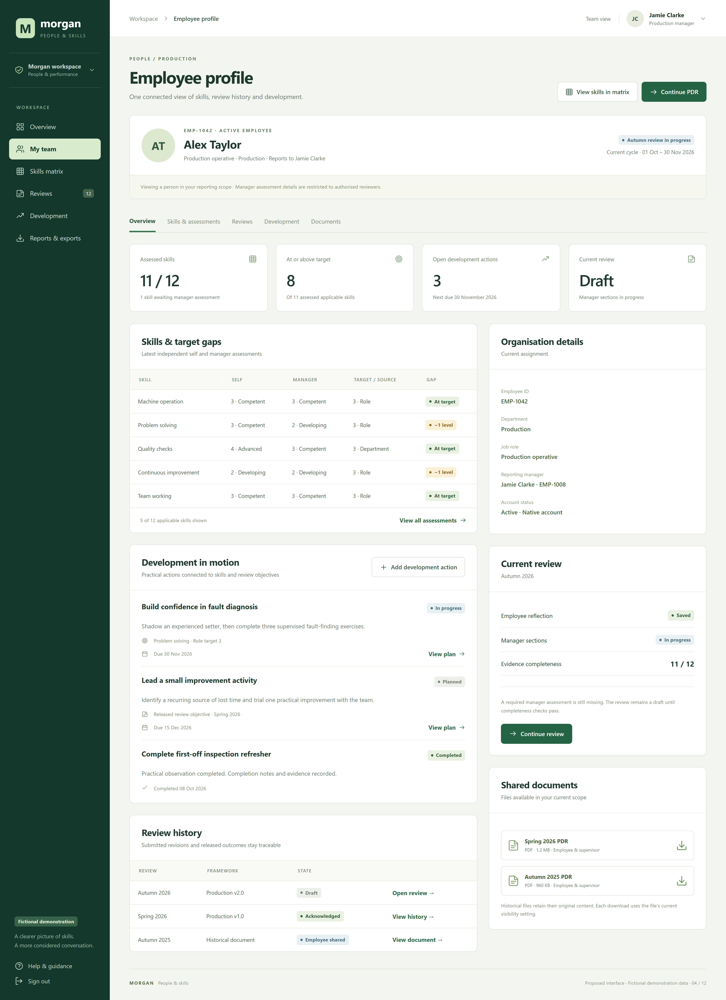](images/visual-design/04-employee-profile.png)

## 05 Manager PDR

A guided manager draft with employee reflection, manager assessment, objectives, a pay proposal and submission completeness. See [review lifecycle and immutable revisions](specification.md#9-review-lifecycle-and-immutable-revisions).

[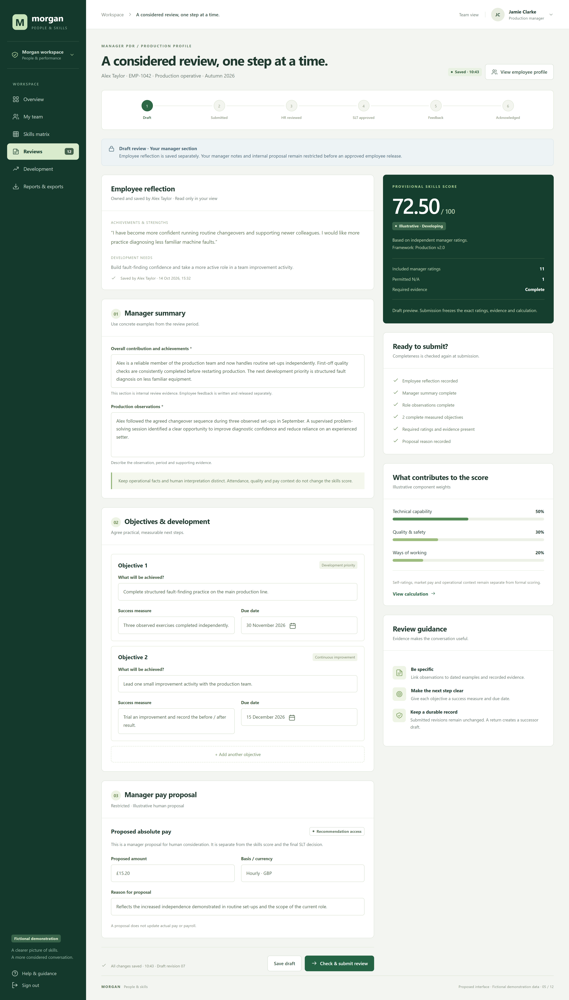](images/visual-design/05-manager-pdr.png)

## 06 Scoring framework

An illustrative framework showing component weights, rating points, a worked calculation and score bands. Live values require HR approval. See [versioned frameworks and explainable scoring](specification.md#7-versioned-frameworks-and-explainable-scoring).

[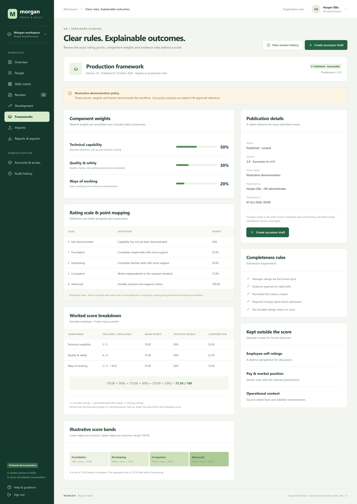](images/visual-design/06-scoring-framework.png)

## 07 HR review

A submitted review with frozen assessment evidence, development objectives, restricted decision context and HR review controls. See [review lifecycle and immutable revisions](specification.md#9-review-lifecycle-and-immutable-revisions).

[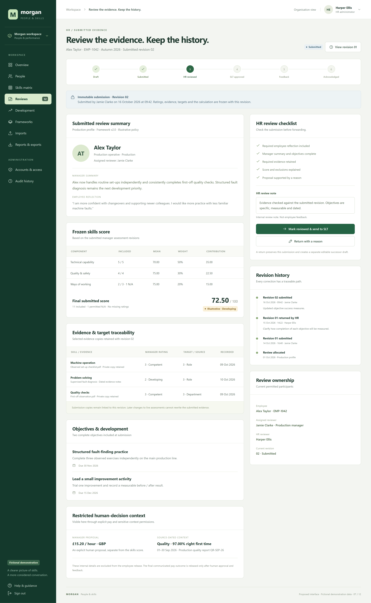](images/visual-design/07-hr-review.png)

## 08 SLT decision

A decision queue and evidence view combining approved review inputs, permitted pay comparisons and operational context for a human decision. See [pay, benchmarks and operational context](specification.md#8-pay-benchmarks-and-operational-context) and [review lifecycle](specification.md#9-review-lifecycle-and-immutable-revisions).

[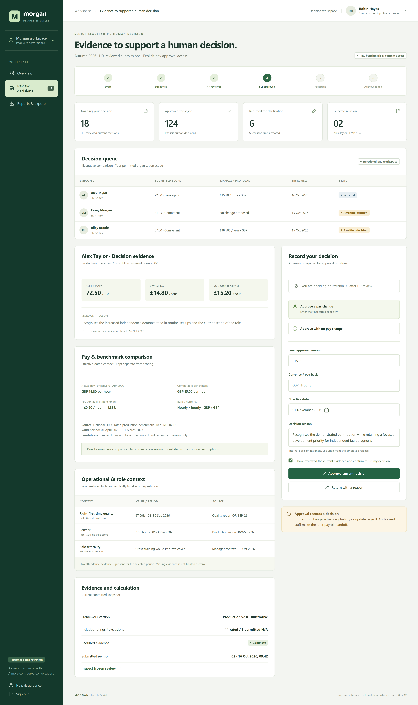](images/visual-design/08-slt-decision.png)

## 09 Employee outcome

An employee-safe released outcome with feedback, objectives, communicated pay terms and receipt or disagreement options. See [review lifecycle and immutable revisions](specification.md#9-review-lifecycle-and-immutable-revisions).

[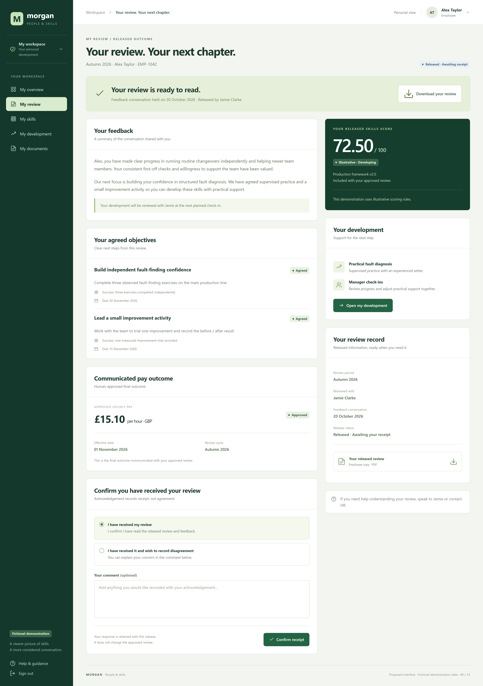](images/visual-design/09-employee-outcome.png)

## 10 Development plan

Owned development actions with due dates, resources, progress updates and completion history. See [development, documents, imports and exports](specification.md#10-development-documents-imports-and-exports).

[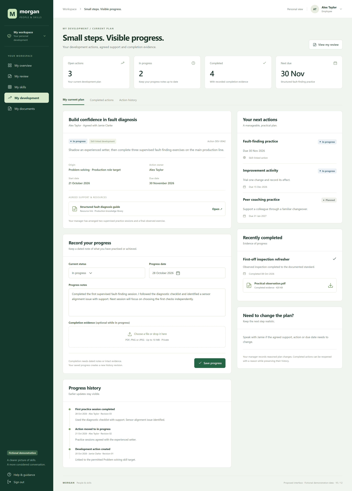](images/visual-design/10-development-plan.png)

## 11 Import validation

A controlled import preview with row validation, mappings, batch details and a reconciliation summary before applying changes. See [development, documents, imports and exports](specification.md#10-development-documents-imports-and-exports).

[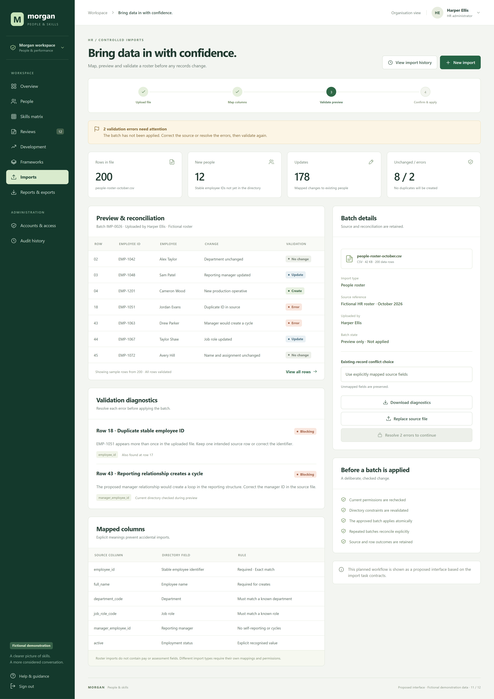](images/visual-design/11-import-validation.png)

## 12 Self-assessment

An employee reflection and rating form with evidence guidance and assessment history. Self-ratings stay separate from the manager assessment used for formal scoring. See [catalogue, targets and assessments](specification.md#6-catalogue-targets-and-assessments).

[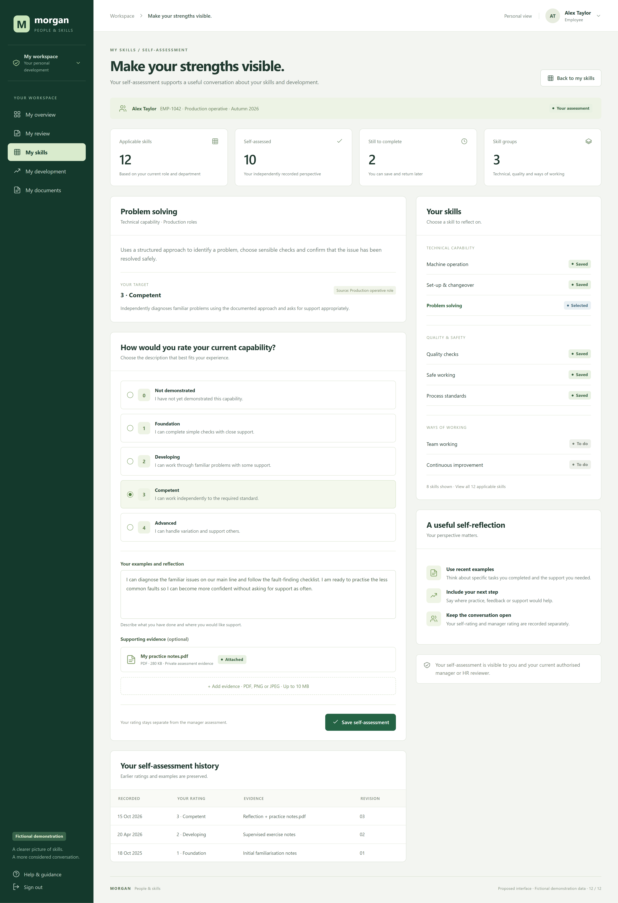](images/visual-design/12-self-assessment.png)
